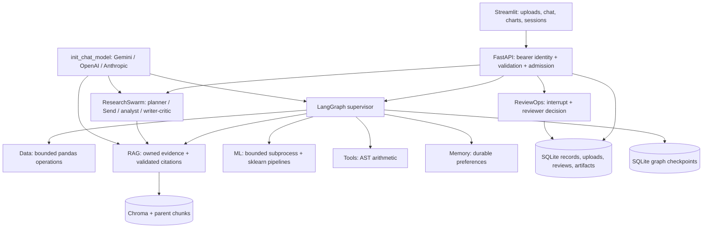

# Architecture and data flow

## Authority stays outside the prompt

The HTTP credential resolves a frozen Principal. Runtime context carries that principal separately from graph state. Every upload/session/preference/chunk/artifact operation scopes SQL to tenant and owner. Retrieval combines requested source/page criteria with mandatory owner filters. A model cannot choose the role, tenant or arbitrary filesystem path. A CSV selected for a chat must belong to the current user and current session.

The assistant routes among five allowlisted specialists. A route decision is schema validated and checked against compatible operations. Demo routing is a visible deterministic baseline; live routing uses structured model output. Agent teams share one provider configuration by default; multi-agent does not require multiple model providers.

## Four kinds of persistence

| Store | Purpose | Identity |
|---|---|---|
| Application SQLite | Sessions, messages, preferences, upload blobs, original parent text, reviews, artifact blobs, audit | Tenant + owner; reviewer authority checked separately |
| LangGraph SQLite | Execution snapshots, next tasks, pending interrupts, accumulated messages | Graph kind + tenant + user + session/review ID |
| Chroma | Child chunk embeddings and trusted metadata | Owner-specific collection + mandatory metadata constraints |
| ADK/A2A SQLite | ADK events/state and remote public-catalog tasks | Separate local operator / public catalog service |

UI session state stores selection and display values, not canonical business decisions. Checkpoints resume execution; application rows remain the authority for final review outcomes. ADK/A2A services expose only their public catalog/operator surfaces and are not mapped into private upload namespaces.

## RAG lifecycle

1. Parse text/PDF with bounded size; PDF parsing runs in a timed child process.
2. Preserve source name and original one-based PDF page number.
3. Split pages into 850-character children with 120 overlap, retain parent page text.
4. Embed and persist children in a backend/model-specific collection.
5. Retrieve owned candidates; optional BM25/vector rank fusion or MMR diversity.
6. Rephrase a conversational follow-up when live mode needs it; use one resulting evidence set for answer and sources.
7. Validate cited chunk IDs against that set. Empty/unsupported evidence leads to no answer.

Document text is untrusted data. Prompt boundaries and citations improve reliability but do not prove every sentence is faithful. The evaluation distinguishes lexical hit checks from human relevance and factuality review. Scanned PDF OCR is not included.

## Human review and idempotency

`new_review` binds an idempotency key to an immutable content/session fingerprint. Reusing it with different content conflicts. The graph pauses at `interrupt` before any export. A reviewer from the same tenant submits approval/rejection and an expected version. One SQLite transaction updates the review and creates exactly one artifact on approval. Rejection creates none. A duplicate identical decision returns the recorded outcome; a stale conflicting decision fails. The graph resumes by reading the committed business decision, so replay cannot invent approval or repeat export creation.

## ML experiment design

Conventional names identify a candidate target; a last-column fallback is explicitly heuristic. Users can override target and problem type. Missing targets are removed. Numeric imputation/scaling and categorical imputation/encoding are inside sklearn pipelines fitted within cross-validation folds. Models are ranked on training-only CV; only the winner is evaluated on the reserved test partition. A dummy baseline is reported. The output is a reproducible comparison JSON, not a deployed model endpoint. Temporal, duplicate, entity-group and semantic leakage require domain-specific splits beyond the supplied random-split experiment.

## Runtime and failure behavior

- Graphs return state deltas; accumulating reducers are not fed their own full history.
- Research branches have bounded work and stable chunk deduplication; revision exhaustion is explicit.
- Provider errors never change live mode into demo mode. Timeouts, retries and a process-local circuit breaker control failures.
- Cache and concurrency controls are process-local. Single-worker operation is part of the supported deployment contract.
- Chroma and SQLite handles close in service lifespan. The Windows integration tests exercise restart behavior.
- Readiness verifies local storage and initialization. It deliberately reports that inference has not been verified by the health probe.

Inspect graph structure in Python with `services.insight.get_graph().draw_mermaid()` and checkpoints with `get_state(config)` / `get_state_history(config)`. A public output schema is not a protection against leaking internal state; trace access must also be restricted.

## HTTP streaming

`POST /v1/chat/stream` uses the same authenticated request contract as `/v1/chat`. It emits SSE `progress` events containing completed node names, followed by a `result` event with the owned answer/payload. It does not stream private raw state. Failures after HTTP headers produce an explicit `error` event, never a successful result. This is graph-progress streaming; the Gradio example separately demonstrates model token chunks. A client must wait for the result/error outcome before treating work as complete.
